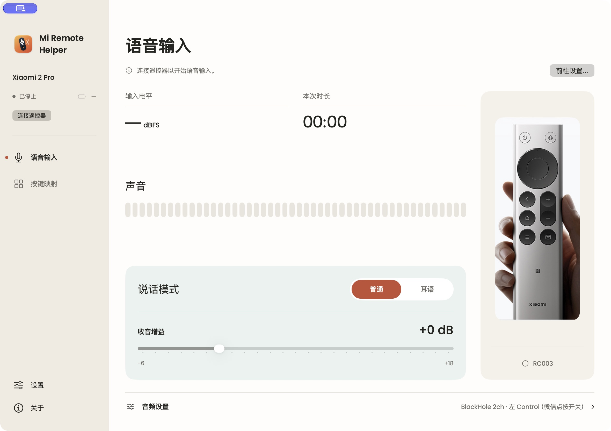
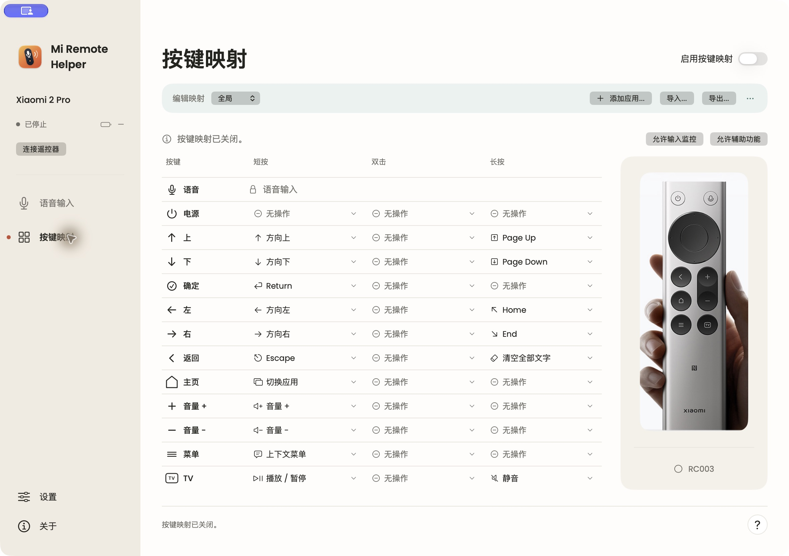

# Mi Remote Helper

[English](README.md) · **简体中文**

[项目网站](https://mi-remote.yangpan.com/zh/)

原生 macOS 应用，将小米蓝牙遥控器 2 Pro（RC003）的麦克风连接到微信输入法，并支持自定义遥控器按键。

按住遥控器语音键说话，松开结束。语音识别由输入法完成；Mi Remote Helper 负责传递音频和触发输入法快捷键。

## 产品截图

语音输入、收音增益与说话模式。



可自定义的短按、双击与长按映射。



## 功能

- RC003 蓝牙连接、型号确认、ATVV 能力协商及断线重连。
- 16 kHz 麦克风音频输出到已安装的 BlackHole 或 MiRemoteV 虚拟设备。
- 左 Control、Fn／地球键均支持输入法的“一次点按开始，再点按结束”模式。
- 增益调整、耳语模式、输入电平、电池状态与短测试音。
- 12 个按键的短按、双击、长按独立配置；语音键专用于语音输入。
- 全局与按应用映射、快捷键录制、JSON 导入导出。
- 可选的连接期间系统输入锁定，避免耳机切换替换所选虚拟麦克风。
- 菜单栏运行、登录启动、简体中文与英文界面。

## 环境要求

- Apple Silicon Mac，macOS 14 或以上。不支持 Intel。当前验证环境为 macOS 27.0.1、Xcode 27。
- 小米蓝牙遥控器 2 Pro，型号 RC003；同一时间只连接一只受支持遥控器。
- 单独安装 [BlackHole 2ch](https://existential.audio/blackhole/)，或使用已安装的兼容 MiRemoteV 设备。项目不附带驱动或安装器。
- 已配置语音输入的微信输入法。尚未验证其他听写工具。
- 按本文从源码构建需要 Xcode 27。尚未验证旧版 Xcode 与 Icon Composer 资源及当前项目设置的兼容性。

## 使用设置

1. 在 macOS 蓝牙设置中配对遥控器。
2. 安装 BlackHole 2ch；安装器可能需要管理员授权和重启。
3. 按下文说明构建并打开 Mi Remote Helper。
4. 在设置中选择虚拟麦克风，选择与微信输入法一致的左 Control 或 Fn／地球键。在微信中将此键设为“一次点按开始，再点按结束”，不要选择按住说话模式。点击“应用设置”。
5. 连接遥控器并允许蓝牙权限。在“辅助功能”允许应用发送快捷键；启用按键映射还需要“输入监控”。若 macOS 要求重新启动应用，退出后重新打开。
6. 若输入法提供音频设备选择，选择同一虚拟麦克风；否则使用系统默认输入。
7. 将焦点放到文本框，按住遥控器语音键说话，松开结束。应用在按下时点按所选快捷键，松开并排空已接收音频后再点按一次。

语音键的短按可按应用自定义，全局默认“无操作”。Codex 默认 **Command + Option + I**（需要在 Codex 中将“聚焦主聊天”设为此快捷键）；Grok Bot 默认 **Command + I**。短按松开时发送快捷键，不启动听写，也不检查文本焦点。长按 0.5 秒后启动语音输入，不会同时执行短按动作。Fn 和左 Control 使用开始／结束点按；右 Option 和 F20 保持按住式快捷键。语音键双击可自定义，默认为无操作；设有双击动作时，短按等待 0.3 秒以区分双击。短按功能需要启用按键映射。

“保持系统输入”默认开启，可在“设置 → 音频”修改。连接期间，应用将所选虚拟麦克风保持为系统输入，并纠正耳机引起的输入切换，不改变播放输出。断开或退出时，仅在输入仍由本应用选择且原设备可用的情况下恢复先前设备。应用仍在运行时，恢复失败会每隔一秒重试，最多三次；仍失败时显示提示，重试不会覆盖后来由外部选择的输入。应用退出时仅尝试同步恢复。关闭此选项后自行管理系统输入；音频路由被打断后的自动恢复仍有效。

设置需要明确应用，未应用的修改可撤销；收音期间不能修改音频设置。测试音用于检查虚拟音频链路，不触发听写。电平表示收到音频，不代表输入法已识别文字。

耳语模式关闭音频平滑滤波，并单独保存增益，初始为 +3 dB。默认关闭，不改变微信的识别模型，也不保证提高识别率。

设置提供独立的“启动时自动连接”（默认开启）与“登录时自动启动”开关。自动连接要求曾连接过遥控器、已保存虚拟麦克风且已有蓝牙权限；首次设置仍需手动完成。遥控器休眠时可能需要按键唤醒。手动断开后本次运行停止重试，重新打开窗口不会再次连接。

## 按键映射

遥控器共有 13 个按键：电源、语音、上、下、左、右、确定、返回、主页、菜单、音量加、音量减和 TV。语音键长按锁定为语音输入，短按和双击可自定义，其余按键均支持独立的短按、双击、长按。

允许辅助功能与输入监控后，在“按键映射”页启用映射。点击对应功能单元格选择动作，选择自定义快捷键会进入录制；修改自动保存。应用映射仅在对应应用处于前台时覆盖全局的指定动作，未覆盖的动作继承全局。内置 Codex 配置初始继承全局，可参考 [Codex 配置示例](Examples/codex.mapping.json)。

| 默认动作 | 按键／手势 |
| --- | --- |
| 应用切换器 | 主页短按 |
| 鼠标指针所在位置的右键菜单 | 菜单短按 |
| 播放／暂停；静音 | TV 短按／长按 |
| Home／End | 左／右长按 |
| Page Up／Page Down | 上／下长按 |
| 清空当前受支持文本框中的全部文字 | 返回长按 |

长按在 0.5 秒后执行一次。双击窗口为 0.3 秒，只有配置了双击动作的按键才延迟短按；OK 默认短按 Return、长按 Shift+Return、双击 Command+Return，其余按键双击默认无操作。已有保存的映射保持不变。手势互斥，不自动连发。Home／End 与翻页动作的实际效果由前台应用决定。

应用切换器打开时，左右选择，确定／主页确认，返回／电源取消。语音键先取消切换，再开始语音。断连或超过 30 秒也会取消切换。

定义可导出为 JSON，导入前可预览。导出采用 v2，导入兼容 v1 与 v2。详见[格式文档](docs/mapping-definitions.zh-CN.md)和[全局默认配置](Examples/global-defaults.mapping.json)。

## 构建与测试

打开 `MiRemoteHelper/MiRemoteHelper.xcodeproj`，选择 `MiRemoteHelper` scheme 和 **My Mac**，或运行：

```sh
xcodebuild -project MiRemoteHelper/MiRemoteHelper.xcodeproj \
  -scheme MiRemoteHelper -configuration Debug \
  -destination 'platform=macOS,arch=arm64' \
  -derivedDataPath build/DerivedData build

xcodebuild -project MiRemoteHelper/MiRemoteHelper.xcodeproj \
  -scheme MiRemoteHelper -destination 'platform=macOS,arch=arm64' \
  -derivedDataPath build/TestDerivedData \
  -only-testing:MiRemoteHelperTests test
```

产物：`build/DerivedData/Build/Products/Debug/Mi Remote Helper.app`。

### 签名

公共配置 `MiRemoteHelper/Config/Build.xcconfig` 默认使用 arm64 与临时签名，无需 Apple 开发者账号，也不绑定维护者的团队。这适合构建和检查源码。临时签名重编译后可能导致蓝牙、辅助功能或输入监控授权失效；日常使用建议持续使用自己的开发证书签名。

```sh
cp MiRemoteHelper/Config/Signing.local.xcconfig.example \
   MiRemoteHelper/Config/Signing.local.xcconfig
```

将复制文件中的 `DEVELOPMENT_TEAM` 改成自己的团队 ID，并在钥匙串中安装对应的 Apple Development 证书。本地文件由 Git 忽略，同时适用于 App 与测试目标。保持签名身份及应用位置稳定；身份改变后，需在系统设置中重新授权。不要提交私钥、证书导出文件或公证凭据。

Release 构建不等于已公证的公开下载包。公开分发二进制还需要单独的 Developer ID Application 证书、Hardened Runtime、公证与 stapling。开发证书不能作为正式公开分发签名方案。详见[发布准备](docs/releasing.zh-CN.md)。

## 隐私与权限

音频链路：遥控器麦克风 → BLE ATVV → IMA ADPCM 解码 → CoreAudio → 虚拟音频设备 → 输入法。

应用不采集 Mac 物理麦克风，不保存录音，不执行转写，也不上传音频。微信输入法的数据处理适用其自身设置与政策。偏好设置和映射保存在本地。

- 蓝牙：与遥控器通信、接收麦克风音频。
- 辅助功能：发送配置的快捷键，并为受支持文本操作检查焦点元素。
- 输入监控：读取匹配遥控器的 HID 报告；正常映射功能不记录其他键盘。

仅 Debug 构建提供键盘诊断，通过环境变量 `MI_REMOTE_VOICE_DIAGNOSTICS=1` 主动开启。观察器读取会话按键事件，仅记录修饰键／语音键元数据，不记录文字或音频。Release 不包含这些诊断。常规协议日志使用 OSLog 私有条目。

最小权限的 Release 策略与产物检查见[权限与安全边界](docs/security.zh-CN.md)。

## 验证与边界

2026-10-08 验证结果：109 项单元测试通过（含参数化用例共 110 次运行），包含许可证打包检查。不含本地签名配置的公开源码快照通过了默认临时签名的 arm64 Release 构建；公共构建和本地开发证书构建均通过严格签名验证。测试覆盖音频解码、蓝牙生命周期、手势、映射校验与恢复、本地化、语音恢复及可配置输入锁定。[验证状态](docs/validation.zh-CN.md)与[性能记录](docs/performance.zh-CN.md)包含有日期的结果及适用边界。

RC003 通过 BlackHole 收音、微信松开结束已进行真机检查，不代表兼容全部固件、输入法或 macOS 版本。XCTest UI 测试在验证机器上因 runner 初始化超时尚未通过。睡眠、重连等完整硬件回归与单元测试分开验证。

主窗口固定为 1180 × 800 pt，关闭窗口后应用仍在菜单栏运行。从 Dock 重新打开已关闭的主窗口时，会在关闭时所在屏幕居中；该屏幕不可用时使用当前屏幕。设置窗口相对调用窗口居中打开。登录启动会打开应用，遥控器需另行连接。RC003 固件要求按住语音键收音。不支持其他型号、多个遥控器或宏脚本。

强制退出或崩溃无法保证执行按键恢复；如有残留屏蔽，断开并重新连接遥控器。避免同时运行其他遥控器映射工具。

## 图标与语言

图标源文件是 `Design/AppIcon.svg`，原生 Icon Composer 文档是 `MiRemoteHelper/MiRemoteHelper/AppIcon.icon`；菜单栏 SVG 也位于 `Design/`。安装 Node.js 并安装或通过 `NODE_PATH` 提供 `sharp` 后，运行 `node scripts/generate-app-icon.cjs` 可重新生成图案。正常 Xcode 构建直接使用已提交资源，无需 Node.js。

“设置 → 语言”提供跟随系统、简体中文和 English。默认跟随 macOS 应用语言，未匹配语言时回退英文。切换后界面立即刷新，无需退出或断开遥控器，只影响本应用。翻译位于 `Localizable.xcstrings`、`InfoPlist.xcstrings`，设备名称保留原值。


技术文档及翻译入口见[文档索引](docs/README.zh-CN.md)。

## 许可证与致谢

软件采用 **GPL-3.0-only**，与 Open Voice Bridge 及其 RC003 上游保持一致。来源、固定版本及修改范围见 [LICENSE](LICENSE) 和[第三方声明](THIRD_PARTY_NOTICES.zh-CN.md)。App 的“关于 → 许可证与致谢”包含这两份文档。公开二进制版本必须提供对应源代码。

Arvo、Poppins 字体按 SIL Open Font License 1.1 打包，并附许可证。BlackHole 是外部依赖，本项目不再分发其驱动。

### 产品照片

遥控器照片来自[小米官方产品页](https://www.mi.com/xiaomi-bluetooth-remote-2-pro)，保留用于展示兼容设备及按键。版权归小米及相关权利人所有。照片不属于 GPL 授权范围，目前没有可再分发授权记录；署名与本说明不替代许可。

如权利人认为使用侵犯其权益，请通过项目 Issue 提供图片位置及权属依据；如有侵权，我们将删除。请先请求私下联系渠道再提供敏感证明材料。详见[照片说明](Design/RemoteProductPhoto.zh-CN.md)。

本项目与小米、微信、OpenAI 无隶属或背书关系，产品名称仅用于说明兼容性。
